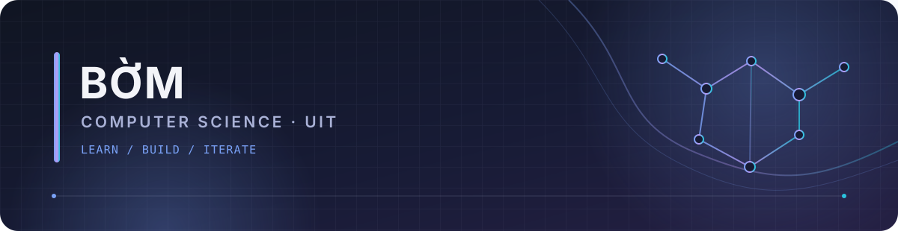
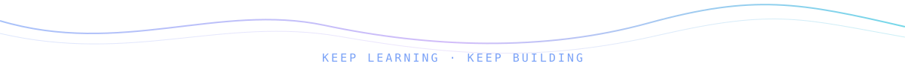

<!--
PROFILE README TEMPLATE
Before publishing, replace every occurrence of buimanhcuong7108 with your exact GitHub username.
For a profile README, the repository name must match your GitHub username.
-->

  

  

  
  
  

  
  

## 👋 About Me

Hi, I'm **Bờm** — a Computer Science student at the **University of Information Technology (UIT)**, interested in understanding how software works and how data can be turned into useful predictions.

- 🧩 **Problem solving:** I have a programming foundation shaped by competitive programming and algorithmic thinking.
- 🤖 **Machine Learning:** Currently studying ML fundamentals through Microsoft's *ML for Beginners* curriculum, with a focus on regression, classification, feature engineering, and model evaluation.
- 🐍 **Data workflow:** Practising Python-based data preparation and model experiments with tools such as pandas, NumPy, and scikit-learn.
- 🛠️ **Developer workflow:** Learning to use Git and GitHub consistently for version control and project collaboration.
- 🎯 **Long-term goal:** Build strong Computer Science fundamentals and turn what I learn into clear, reproducible projects.

## 🧰 Tech Stack & Toolkit

<strong>Programming & Developer Tools</strong>

  

<strong>Data & ML — currently learning</strong>

  
  
  
  

<strong>Concepts I'm practising</strong>

  
  
  
  
  

## 🧭 Current Learning Roadmap

| Track | What I'm working on | Status |
| --- | --- | --- |
| 🤖 **Machine Learning** | Regression, classification, feature selection, encoding categorical variables, and evaluation metrics such as RMSE and R² | 🟡 In progress |
| 🧹 **Data Preparation** | Exploring DataFrames, missing values, one-hot encoding, and preparing data for training | 🟡 In progress |
| 🌿 **Git & GitHub** | Staging, commits, branches, remotes, reset/restore, and the push–pull–fetch workflow | 🟡 In progress |
| 🧠 **CS Foundations** | Continuing to strengthen algorithmic thinking and problem-solving habits | 🔁 Ongoing |

## 🔬 Learning Lab

### 🎃 Pumpkin Price Prediction

A hands-on learning exercise based on the **US pumpkins dataset** from Microsoft's *ML for Beginners* curriculum.

- 🧪 Experimenting with feature selection and categorical feature encoding.
- 🧱 Practising the training workflow from data preparation to model evaluation.
- 📏 Comparing metrics and investigating why different preprocessing choices can change model scores.

> This is a learning exercise, not a claim of a finished production model. I'll add links here as I publish standalone repositories and project write-ups.

## 📊 GitHub Analytics

  
  

  

  📌 These cards reflect activity in public repositories; language distribution is not a measure of proficiency.

### 🐍 Contribution Flow

  

## 🤝 Let's Connect

I'm interested in conversations about **Computer Science fundamentals, beginner-friendly ML experiments, and building better development habits**. Feel free to open a discussion or issue in one of my repositories.

  

  <em>“Build a strong foundation. Stay curious. Improve one iteration at a time.”</em> 🚀

  

